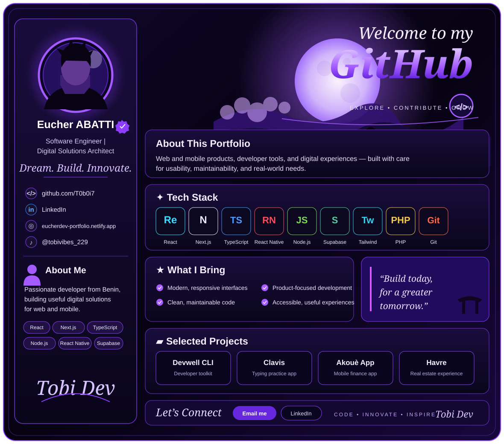

  

  <a href="mailto:abattieucher@gmail.com">Email</a> ·
  <a href="https://linkedin.com/in/eucher-abatti-7a9472283">LinkedIn</a> ·
  <a href="https://eucherdev-portfolio.netlify.app">Portfolio</a> ·
  <a href="https://github.com/T0b0i7">GitHub</a>

## Featured projects

- **[Devwell CLI](https://github.com/T0b0i7/devwell-cli)** — developer tools for repository health and maintenance.
- **[Clavis](https://github.com/T0b0i7/Clavis)** — typing practice app built with Next.js, React, and TypeScript.
- **[Akouè App](https://github.com/T0b0i7/akoue-app)** — personal finance mobile app built with Expo, React Native, and Supabase.
- **[Havre](https://github.com/T0b0i7/havre)** — real-estate web experience with a catalogue and 3D visit.

## Contact

Available for freelance collaborations and digital product development. Contact me at [abattieucher@gmail.com](mailto:abattieucher@gmail.com).
